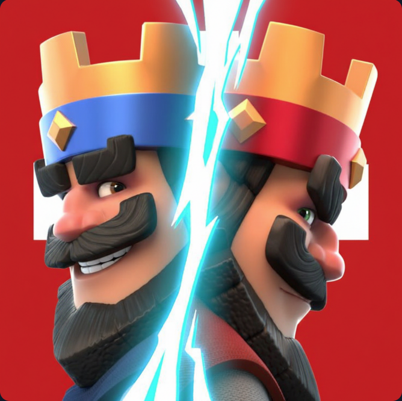

<div align="center">



# MH Legacy — Clash Royale Stats

**Le site Clash Royale suisse 🇨🇭 : cartes, deck builder, stats de joueur, nouveautés et e-sport.**


[Fonctionnalités](#-fonctionnalités) •
[Pages](#-pages) •
[Installation](#-installation) •
[Structure](#-structure-du-projet) •
[Données](#-données-et-automatisation) •
[Auteur](#-auteur)

</div>

---

## 📖 À propos

**Clash Royale Stats** est un site web interactif destiné aux joueurs suisses et francophones de Clash Royale. Il centralise sur une seule plateforme :

- les **cartes** du jeu avec leurs descriptions,
- un **deck builder** avec calcul de l'élixir moyen,
- les **statistiques d'un joueur** (profil, deck actuel, 20 derniers combats),
- les **nouveautés** (saisons, équilibrages, événements),
- les **équipes e-sport** et la Clash Royale League.

Le site est 100 % statique (HTML, CSS, JavaScript natif, sans framework). Les cartes viennent d'une base de données JSON locale, et les stats du joueur d'un petit Worker Cloudflare qui interroge l'API officielle.

## ✨ Fonctionnalités

| | Fonctionnalité | Détail |
|---|---|---|
| 🃏 | **Collection de cartes** | Plus de 160 cartes : normales, évolutions, héros, champions et tours |
| 🧱 | **Deck builder** | Glisser-déposer ou clic pour remplir les 8 cases, clic droit pour vider, calcul de l'élixir moyen |
| 🔎 | **Fiches de cartes** | Recherche par nom et filtre par rareté (commune, rare, épique, légendaire, champion, héros) |
| 📊 | **Stats de joueur** | Trophées, record, victoires/défaites, taux de victoire, 3 couronnes, deck actuel, 20 derniers combats |
| 📰 | **Nouveautés** | Équilibrages (nerfs, buffs, refontes) classés par saison |
| 🏆 | **E-sport** | Team Liquid, SK Gaming, Tribe Gaming : gains, tournois, records de spectateurs |
| 🎬 | **CRL** | Vidéos et moments forts de la Clash Royale League |
| ♿ | **Accessibilité** | Lien d'évitement, navigation au clavier, `aria-label`, `aria-live` |
| 📱 | **Responsive** | Mise en page adaptée mobile, tablette et ordinateur |

## 🗺️ Pages

| Page | Fichier | Rôle |
|---|---|---|
| Accueil | `index.html` | Présentation et recherche de joueur par tag |
| Cartes | `cartes.html` | Deck builder |
| Fiches | `description_cartes.html` | Descriptions, recherche et filtres |
| Nouveautés | `news.html` | Équilibrages par saison |
| E-sport | `e-sport.html` | Équipes et tournois |
| Clans | `clan_site.html` | Page clan |
| CRL | `crl.html` | Vidéos de la Clash Royale League |
| Contact | `contact.html` | Formulaire et présentation de l'auteur |

## 🚀 Installation

Aucune dépendance à installer : c'est un site statique.

```bash
# 1. Cloner le dépôt
git clone https://github.com/<ton-utilisateur>/Clash-Royale-Stats-Martin.git
cd Clash-Royale-Stats-Martin

# 2. Lancer un petit serveur local (au choix)
npx serve .
# ou
python -m http.server 8000
```

Ouvre ensuite `http://localhost:8000` dans ton navigateur.

> ⚠️ Ne double-clique pas sur `index.html` (adresse `file://`) : le navigateur bloque le chargement des fichiers JSON. Utilise un serveur local, l'extension **Live Server** de VS Code, ou **GitHub Pages**.

### Publier avec GitHub Pages

1. Va dans **Settings → Pages**.
2. Choisis **Deploy from a branch**, la branche `main` et le dossier `/ (root)`.
3. Le site sera disponible à l'adresse `https://<ton-utilisateur>.github.io/<nom-du-depot>/`.

## 🧩 Structure du projet

```text
.
├── index.html                 # Accueil + recherche de joueur
├── cartes.html                # Deck builder
├── description_cartes.html    # Fiches des cartes
├── news.html                  # Nouveautés
├── e-sport.html               # E-sport
├── clan_site.html             # Clans
├── crl.html                   # Clash Royale League
├── contact.html               # Contact
├── css/
│   ├── style.css              # Styles communs (variables, nav, titres, boutons)
│   ├── home.css, cards.css, description.css, news.css,
│   └── esports.css, clans.css, contact.css, recherche.css
├── js/
│   ├── nav.js                 # Menu de navigation partagé
│   ├── database.js            # Chargement de data/cards.json
│   ├── cards.js               # Deck builder
│   ├── description.js         # Fiches, recherche et filtres
│   ├── recherche.js           # Stats d'un joueur (Worker + secours JSON)
│   └── stats.js               # Affichage de data/player.json
├── data/
│   ├── cards.json             # Base de données des cartes
│   └── player.json            # Profil du joueur (généré automatiquement)
├── scripts/
│   └── fetch-player.js        # Récupère le profil via l'API
├── images/                    # Logos, bannières, illustrations
├── videos/                    # Vidéos du site
└── .github/workflows/
    └── update-cards.yml       # Mise à jour quotidienne de player.json
```

## 🔄 Données et automatisation

### Base de cartes

`data/cards.json` contient les cartes avec leur `id`, nom, variante (`normal`, `evolution`, `hero`, `champion`, `tower`, `temporary`), coût en élixir, rareté, catégorie, image et description en français.

Les images des cartes sont chargées depuis le CDN de RoyaleAPI (`cdn.royaleapi.com/static/img/cards-150/`). Pour les héberger toi-même, télécharge le dossier `cards-150` du dépôt [RoyaleAPI/cr-api-assets](https://github.com/RoyaleAPI/cr-api-assets) et adapte `CARD_IMG_BASE` dans `js/database.js`.

### Stats du joueur

- **En direct :** `js/recherche.js` interroge un Worker Cloudflare qui appelle l'API officielle de Clash Royale et renvoie le profil et les 20 derniers combats.
- **Secours :** si le Worker ne répond pas, le site affiche le profil enregistré dans `data/player.json`.

### Mise à jour automatique

Le workflow `.github/workflows/update-cards.yml` s'exécute **chaque jour à 06:00 UTC** (ou manuellement) :

1. il lance `scripts/fetch-player.js`,
2. il met à jour `data/player.json`,
3. il commit et push les changements.

Pour l'activer, ajoute ta clé d'API dans **Settings → Secrets and variables → Actions** sous le nom `CR_API_KEY`. Une clé s'obtient sur le portail développeur [RoyaleAPI](https://docs.royaleapi.com/) (proxy) ou [developer.clashroyale.com](https://developer.clashroyale.com/).

## 🛠️ Technologies

- **HTML5 sémantique** et **CSS3** (variables, grid, flexbox, `clamp()`, thème sombre doré)
- **JavaScript natif** (ES2020+, `fetch`, glisser-déposer natif)
- **Polices :** [Bungee](https://fonts.google.com/specimen/Bungee) et [Nunito](https://fonts.google.com/specimen/Nunito)
- **Cloudflare Workers** pour le proxy d'API
- **GitHub Actions** pour la mise à jour des données

## 🧭 Pistes d'amélioration

- [ ] Page Clans avec les vraies données du clan
- [ ] Héberger localement les images des cartes
- [ ] Copier un deck directement vers le jeu
- [ ] Section nouveautés interactive (changement de saison)
- [ ] Mode clair

## 👤 Auteur

**Martin** — apprenti informaticien à l'**ETML**, passionné de jeux vidéo, créateur de vidéos Clash Royale.

[](https://www.youtube.com/@mhlgcr_off)

## ⚖️ Mentions légales

Ce contenu n'est pas affilié à, sponsorisé ni spécifiquement approuvé par Supercell, et Supercell n'est pas responsable de ce contenu. Pour plus d'informations, consulte la [politique relative au contenu des fans](https://supercell.com/en/fan-content-policy/) de Supercell. Clash Royale est une marque de Supercell.

---

<div align="center">

Fait avec ❤️ en Suisse 🇨🇭

</div>